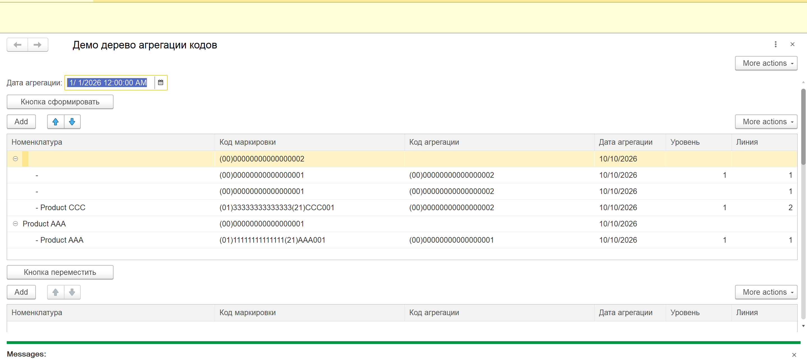

markdown
# Дерево агрегации кодов маркировки / Marking Codes Aggregation Tree

Внешняя обработка для 1С:Предприятие 8.3 — построение и управление деревом кодов маркировки (отец → сыновья).

External Data Processor for 1C:Enterprise 8.3 — building and managing a tree of marking codes (parent → children).

---

## 📸 Скриншоты / Screenshots

### Главное окно / Main Window

---

## 🇷🇺 Русский

### 🎯 Описание

Демонстрационный проект, показывающий полный цикл работы с деревом кодов маркировки на платформе 1С:Предприятие:

- **Построение дерева** — иерархия отец → сыновья из регистра сведений
- **Перемещение отца** — отец и его дети переходят в отдельное дерево
- **Загрузка кодов без отца** — коды с `КодАгрегации = 0`
- **Связь сыновей с отцом** — обновление связи в базе данных
- **Работа с таблицей штрихкодов** — добавление и очистка
- **Отсоединение сына от отца** — возврат сына в дерево без отца
- **Извлечение GTIN из кода GS1** — парсинг штрихкодов
- **Поиск номенклатуры** по штрихкоду

### 💡 Назначение

Проект создан как демонстрация навыков разработки на платформе 1С:Предприятие 8.3.

### ✨ Ключевые особенности

| Особенность | Описание |
|-------------|----------|
| **Работа с деревом значений** | `ДеревоЗначений` — иерархия отец → сыновья |
| **Асинхронные вызовы** | `Асинх / Ждать` на клиенте |
| **Наборы записей** | `НаборЗаписей.Записать()` |
| **Обработка ошибок** | `Попытка / Исключение` |
| **Двуязычные комментарии** | Русский + Английский |
| **Работа с GS1** | Извлечение GTIN из штрихкода |

### 📋 Требования

- **1С:Предприятие 8.3** (платформа разработки)
- **Регистр сведений** `демо_АгрегацияКодовМаркировки`:

| Поле | Тип | Назначение |
|------|-----|------------|
| `КодМаркировки` | Строка(200) | Измерение (ключ) |
| `ИдентификаторОбмена` | Строка(100) | Измерение (ключ) |
| `ХешСуммаКодаМаркировки` | Строка(200) | Ресурс |
| `КодМаркировкиBase64` | Строка(500) | Ресурс |
| `КодАгрегации` | Строка(200) | Ресурс |
| `КодАгрегацииBase64` | Строка(500) | Ресурс |
| `ДатаАгрегации` | Дата | Реквизит |
| `Линия` | Число(2,0) | Реквизит |
| `Уровень` | Число(2,0) | Реквизит |

- **Регистр сведений** `ШтрихкодыНоменклатуры`:

| Поле | Тип | Назначение |
|------|-----|------------|
| `Штрихкод` | Строка(200) | Измерение (GTIN) |
| `Номенклатура` | СправочникСсылка.Номенклатура | Ресурс |

- **Справочник** `Номенклатура` (стандартный)

### 🚀 Использование

1. Открыть обработку `демо_ДеревоАгрегацииКодов.epf`
2. Указать `Дата агрегации`
3. Нажать **Кнопка Сформировать** — построить дерево
4. Выбрать отца в первом дереве
5. Нажать **Кнопка Переместить** — отец и дети перейдут во второе дерево
6. Нажать **Кнопка Загрузить Коды** — коды без отца в третье дерево
7. Выбрать сыновей в третьем дереве и нажать **Кнопка Связать** — привязать к отцу
8. Нажать **Кнопка Показать Баркод** — добавить штрихкоды в таблицу
9. Нажать **Кнопка Отсоединить** — вернуть сына в третье дерево

---

## 🇬🇧 English

### 🎯 Description

A demo project showcasing a complete workflow for managing a tree of marking codes on the 1C:Enterprise platform:

- **Building a tree** — parent → children hierarchy from an information register
- **Moving a parent** — parent and his children move to a separate tree
- **Loading parentless codes** — codes with `КодАгрегации = 0`
- **Linking children to a parent** — updating the link in the database
- **Barcode table operations** — add and clear
- **Detaching a child from a parent** — return child to the parentless tree
- **GTIN extraction from GS1 code** — parsing barcodes
- **Nomenclature lookup** by barcode

### 💡 Purpose

The project is created as a demonstration of 1C:Enterprise 8.3 development skills.

### ✨ Key Features

| Feature | Description |
|---------|-------------|
| **Value Tree operations** | `ДеревоЗначений` — parent → children hierarchy |
| **Async calls** | `Async / Await` on the client |
| **Record sets** | `RecordSet.Write()` |
| **Error handling** | `Try / Except` |
| **Bilingual comments** | Russian + English |
| **GS1 handling** | Extract GTIN from barcode |

### 📋 Requirements

- **1C:Enterprise 8.3** (development platform)
- **Information register** `демо_АгрегацияКодовМаркировки` (see structure above)
- **Information register** `ШтрихкодыНоменклатуры` (see structure above)
- **Catalog** `Номенклатура` (standard)

### 🚀 Usage

1. Open the processor `демо_ДеревоАгрегацииКодов.epf`
2. Set the `Aggregation date`
3. Click **Build Tree** — build the tree
4. Select a parent in the first tree
5. Click **Move Parent** — parent and children move to the second tree
6. Click **Load Codes** — parentless codes go to the third tree
7. Select children in the third tree and click **Link** — attach them to the parent
8. Click **Show Barcode** — add barcodes to the table
9. Click **Detach** — return a child to the third tree

---

## 📁 Структура проекта / Project Structure
.
├── README.md
├── LICENSE
├── .gitignore
├── демо_ДеревоАгрегацииКодов.epf # Внешняя обработка
├── screenshot-main.png # Скриншот
└── src/
└── Module.bsl # Исходный код модуля

text

---

## 🛠 Технологии / Technologies

| Технология | Применение |
|------------|------------|
| **1С:Предприятие 8.3** | Платформа разработки |
| **Язык запросов 1С** | Чтение данных из регистра |
| **ДеревоЗначений** | Иерархическое представление |
| **НаборЗаписей** | Запись данных в регистр |
| **Попытка / Исключение** | Обработка ошибок |

---

## 🔮 Возможные улучшения / Possible Improvements

- [ ] Валидация данных перед записью
- [ ] Экспорт данных в Excel
- [ ] Просмотр штрихкодов (печать)
- [ ] Юнит-тесты
- [ ] Поддержка больших объёмов данных

---

## 📝 Лицензия / License

MIT License — см. файл [LICENSE](LICENSE)

---

## 👤 Автор / Author

**Ghasson Shadi**

- GitHub: [@ghassonshadi5-tech](https://github.com/ghassonshadi5-tech)

---

## 🙏 Благодарности / Acknowledgments

Проект создан как демонстрация навыков разработки на платформе 1С:Предприятие.

Project created as a demonstration of 1C:Enterprise development skills.